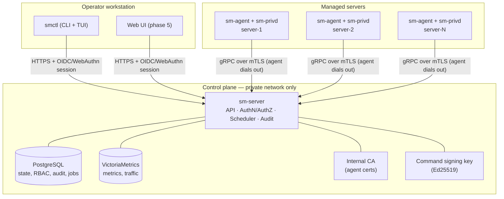
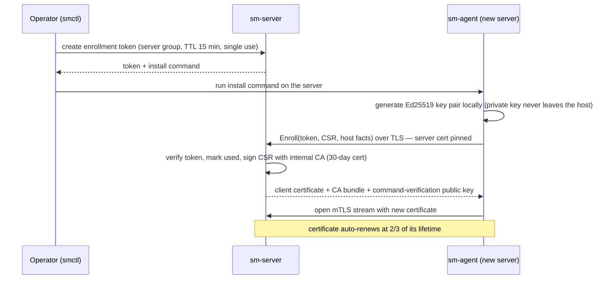
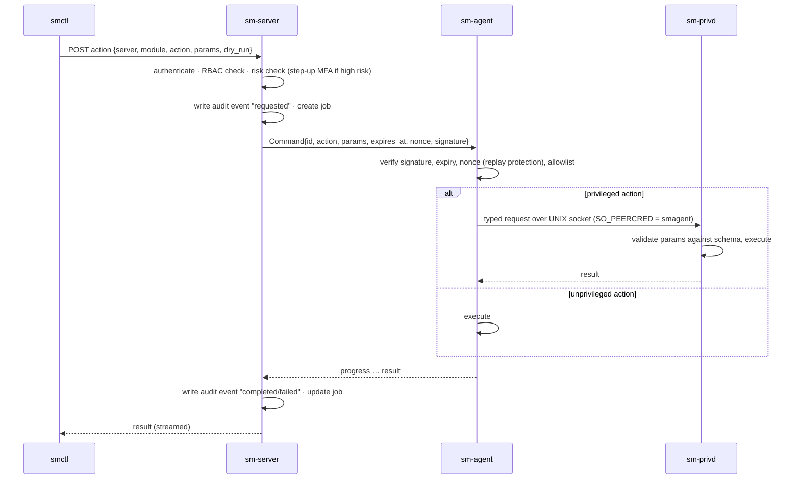

# Server Manager — Architecture

Status: **Draft v0.1** · Owner: project maintainer · Last updated: 2026-11-19

A self-hosted, console-first platform for managing a fleet of Linux cloud servers
from a single point: monitoring, Docker, databases, services, processes, firewall,
banned IPs, audit logs, traffic, disk, swap, timezone, security posture and domains.

---

## 1. Goals and non-goals

### Goals

| # | Goal | What it means in practice |
|---|------|---------------------------|
| G1 | **Secure by default** | No inbound management port on managed servers. mTLS everywhere. MFA for humans. Every action is authorized and audited. |
| G2 | **Efficient** | Agent ≤ 30 MB RSS and < 1 % CPU when idle. One long-lived connection per server. Binary protobuf transport. |
| G3 | **Single point of control** | One CLI/TUI (and later a web UI) for every server, with server groups and bulk actions. |
| G4 | **Safe operations** | Typed actions only, dry-run first, confirmation for risky actions, automatic rollback where a mistake could lock you out (firewall, SSH, network). |
| G5 | **Simple to run** | Control plane is a single binary + PostgreSQL + VictoriaMetrics. Agent is one static binary installed as a systemd service. |

### Non-goals (for v1)

- Not a configuration-management tool (no Ansible/Puppet-style desired-state engine).
- Not a cloud-provider console (no creating VMs on AWS/GCP/Hetzner — may come later through provider APIs).
- No Windows or macOS agents. Linux with systemd only.
- No multi-tenant SaaS. One organization per installation.

### Supported server platforms (v1)

Ubuntu 22.04 / 24.04, Debian 12 / 13, RHEL 9 and derivatives (Rocky, Alma). `amd64` and `arm64`.

---

## 2. System overview



The control plane sits on a **private network** (WireGuard, or a self-hosted
Headscale/Tailscale tailnet). Agents and operators reach it through that network,
so neither the control plane nor any managed server exposes a management port to
the public internet.

### Components

| Component | Binary | Runs on | Responsibility |
|-----------|--------|---------|----------------|
| Control plane | `sm-server` | 1 management host (HA later) | Public API for operators, agent gateway, authentication, RBAC, job scheduling, audit log, alerting, PKI. |
| Agent | `sm-agent` | Every managed server, unprivileged user `smagent` | Keeps the connection to the control plane, collects metrics and logs, runs read-only modules, forwards privileged actions to `sm-privd`. |
| Privileged helper | `sm-privd` | Every managed server, root, local only | Runs a fixed, typed set of privileged actions (firewall, swap, services, packages …). No network access; listens only on a local UNIX socket. |
| Console | `smctl` | Operator workstation | CLI for scripting and a full-screen TUI for interactive use. |
| Web UI | (phase 5) | Browser | Same API as `smctl`. |

`sm-agent` and `sm-privd` ship as **one binary** with two subcommands and two
systemd units, so there is one file to install and update.

---

## 3. Agent ↔ control-plane communication

### 3.1 Transport

- **ConnectRPC** (gRPC-compatible) over HTTP/2 with **mutual TLS 1.3**.
  ConnectRPC speaks gRPC to agents and JSON/HTTP to browsers from the same
  handlers, which keeps the web UI simple later.
- The **agent always dials out**. One bidirectional stream per agent carries:
  heartbeats, metric batches, log/event batches, commands (control plane → agent),
  and command results / progress (agent → control plane).
- Reconnects use exponential back-off with jitter (1 s → 60 s cap).
- Metrics and events are buffered on disk on the agent (bounded ring buffer, 50 MB
  default) while disconnected, then replayed.

### 3.2 Enrollment



- The control plane's TLS certificate fingerprint is embedded in the install
  command, so a new agent cannot be tricked by a man-in-the-middle during enrollment.
- Revoking a server deletes its certificate record; the gateway checks every
  connection against the database, so revocation is immediate (no CRL lag).

### 3.3 Command flow



**Why sign commands when mTLS already authenticates the channel?** Defense in
depth. The signing key is separate from the TLS key and can live in a KMS/HSM.
Signatures with a short expiry (60 s) and a nonce stop replay, and they guarantee
that a command really came from the control plane's scheduler even if a proxy or
load balancer sits in the path.

---

## 4. Action model

Everything an operator can do is a **typed action** defined in protobuf. The agent
has no "run this shell string" endpoint in normal operation.

```protobuf
// Example
message ServiceRestartRequest {
  string unit = 1;  // validated: ^[a-zA-Z0-9@._-]+\.service$
}
```

Each action declares:

| Property | Values | Effect |
|----------|--------|--------|
| `privilege` | `unprivileged` / `privileged` | Privileged actions run in `sm-privd`. |
| `risk` | `read` / `low` / `medium` / `high` / `critical` | Drives RBAC, confirmation prompts and step-up MFA. |
| `supports_dry_run` | bool | Dry run shows the exact change without applying it. |
| `rollback` | none / automatic / manual | E.g. firewall changes roll back automatically if not confirmed. |
| `idempotency` | bool | Safe to retry after a lost result. |

Risk handling:

| Risk | Example | Requirement |
|------|---------|-------------|
| read | list containers, view metrics | `viewer` role |
| low | restart a container, clean apt cache | `operator` role |
| medium | stop a service, kill a process, change swap | `operator` + typed confirmation |
| high | firewall rule change, ban/unban IP ranges, DB user changes | `admin` + step-up MFA |
| critical | drop database, delete volumes, interactive shell | `admin` + step-up MFA + reason text; optional second approver |

### Safety rollback (example: firewall)

1. `sm-privd` saves the current nftables ruleset.
2. Applies the new ruleset.
3. Starts a 90-second timer.
4. The control plane must confirm over a **new** connection that the agent is still
   reachable. If confirmation does not arrive, `sm-privd` restores the saved ruleset.

The same pattern is used for SSH daemon config and network changes.

### Break-glass shell

An interactive shell is available only as a `critical` action: disabled by
default per server group, time-limited (15 min), fully recorded (asciinema-style
cast stored with the audit event) and announced to other admins.

---

## 5. Security model

### 5.1 Threats considered

| Threat | Mitigation |
|--------|------------|
| Attacker scans managed servers for a management port | Agents listen on nothing. `sm-privd` uses a local UNIX socket only. |
| Stolen operator password | OIDC or local accounts with mandatory WebAuthn (preferred) or TOTP. Short sessions (8 h, idle 30 min). |
| Stolen operator laptop/session | Step-up MFA for high/critical actions, session revocation, device-bound refresh tokens. |
| Compromised agent on one server | Its certificate is valid for its own identity only; it cannot read other servers' data or send commands. Revoke in one step. |
| Compromised control plane database | Command-signing key not stored in the DB (file with strict permissions or KMS). Secrets encrypted at rest (envelope encryption). |
| Command injection through parameters | Typed protobuf params, regex/enum validation in both agent and helper, `exec` with argument arrays — never through a shell. |
| Replay of captured commands | Signature + 60 s expiry + nonce cache on agent. |
| Insider covering their tracks | Append-only, hash-chained audit log; optional streaming copy to external storage (S3 object-lock, syslog). |
| Malicious update of the agent | Release binaries signed with cosign; agent verifies signature and checksum before self-update. |
| Supply-chain vulnerabilities | `govulncheck`, Dependabot/Renovate, SBOM per release, minimal dependencies. |

### 5.2 Authentication and authorization

- **Humans:** OIDC (Google, GitHub, Keycloak, Authentik …) or built-in local
  accounts. MFA is required for every account. Passwords hashed with Argon2id.
- **CLI:** OAuth 2.0 device-code flow; tokens stored in the OS keyring.
- **Agents:** mTLS client certificates issued by the internal CA. Certificate
  subject = server UUID.
- **RBAC:** roles (`viewer`, `operator`, `admin`, `owner`) bound to users **per
  server group**, e.g. `alice` is `admin` on `staging` and `viewer` on `production`.
  Custom roles can allow or deny individual modules.
- **API tokens** for automation are scoped (groups + modules + max risk) and expire.

### 5.3 Agent hardening

- `sm-agent` runs as `smagent` with systemd sandboxing: `NoNewPrivileges=yes`,
  `ProtectSystem=strict`, `ProtectHome=yes`, `PrivateTmp=yes`,
  `RestrictAddressFamilies=AF_UNIX AF_INET AF_INET6 AF_NETLINK`,
  `SystemCallFilter=@system-service`.
- `sm-privd` runs as root but has **no network access**
  (`IPAddressDeny=any`, `RestrictAddressFamilies=AF_UNIX AF_NETLINK`), accepts
  connections only from the `smagent` UID (checked with `SO_PEERCRED`), and exposes
  only the typed privileged actions.
- **Docker socket caveat:** access to `/var/run/docker.sock` equals root. Docker
  calls therefore go through `sm-privd`, never directly from `sm-agent`.

### 5.4 Audit log

Every request writes an event: actor, auth method, source IP, server(s), action,
parameters (secrets redacted), risk, result, duration, and
`hash = SHA-256(previous_hash || event)`. A daily job verifies the chain and alerts
on any break. On-server security events (SSH logins, sudo, `auditd`) are collected
into the same store so one search covers both "what did operators do" and "what
happened on the server".

### 5.5 Secrets

Database passwords, DNS-provider tokens and similar are encrypted with a data key,
which is encrypted with a master key (file, `age` identity, or cloud KMS). Secrets
are decrypted only at the moment they are sent to an agent and are never logged.

---

## 6. Feature modules

Each module is a Go package implementing the same interface on the agent side
(`Describe()`, `Collect()`, `Handle(action)`) plus a matching service on the control
plane. Modules can be disabled per server group.

| Module | Data source / mechanism | Example actions | Max risk |
|--------|-------------------------|-----------------|----------|
| **system** (dashboard) | `/proc`, `/sys`, gopsutil | host facts, CPU/RAM/disk/load/uptime | read |
| **services** | systemd over D-Bus (`go-systemd`) | list, status, start/stop/restart, enable/disable, unit logs | medium |
| **processes** | `/proc` | list, tree, top, send signal | medium |
| **logs / audit** | journald API, `/var/log/auth.log`, `auditd` | search, tail, SSH-login history, sudo history | read |
| **docker** | Docker Engine API (via `sm-privd`) | containers, images, volumes, networks, logs, stats, start/stop, prune | critical (volume delete) |
| **database** | MySQL/MariaDB/PostgreSQL over local socket | list DBs/users, create user/DB, grant, backup/restore, slow queries | critical (drop) |
| **traffic** | `/proc/net/dev`, nftables counters, conntrack; eBPF later | per-interface rates, top talkers, monthly totals | read |
| **firewall** | nftables (`google/nftables`); ufw/firewalld adapters | list, add/remove rule, default policy, with auto-rollback | high |
| **banned IPs** | CrowdSec (preferred) or fail2ban | list bans, ban/unban, fleet-wide blocklist | high |
| **time** | `org.freedesktop.timedate1` over D-Bus | timezone, NTP on/off, clock status | low |
| **disk** | statfs, `du`-style walker, package managers | usage, largest files, journal vacuum, package cache, old kernels, Docker prune (dry-run first) | medium |
| **swap** | `swapon`, `/etc/fstab`, `vm.swappiness` | create/resize/remove swapfile, tune swappiness | medium |
| **security** | built-in checks + optional Lynis | SSH config audit, pending updates, open ports, SUID changes, score per server | read / low |
| **updates** | apt / dnf | list pending, install security updates, reboot-required | medium |
| **domains & TLS** | Caddy or Nginx config + ACME (`lego`), DNS-provider APIs | add domain/vhost, issue/renew cert, DNS records, expiry alerts | high |
| **alerts** | control plane rule engine | thresholds (disk > 90 %, cert expiry < 14 d, agent offline), notify Telegram/e-mail/Slack/webhook | — |

---

## 7. Data model (PostgreSQL)

Core tables (simplified):

```
users(id, email, name, auth_provider, mfa_required, created_at, disabled_at)
webauthn_credentials(id, user_id, public_key, sign_count, created_at)
roles(id, name, permissions jsonb)
role_bindings(user_id, role_id, server_group_id)
api_tokens(id, user_id, hash, scopes jsonb, expires_at)

server_groups(id, name, settings jsonb)          -- module toggles, shell policy
servers(id uuid, name, group_id, hostname, os, arch, agent_version,
        labels jsonb, last_seen_at, status)
agent_certificates(serial, server_id, not_after, revoked_at)
enrollment_tokens(id, hash, group_id, expires_at, used_at, created_by)

jobs(id, actor_id, server_id, module, action, params jsonb, risk,
     status, created_at, started_at, finished_at, result jsonb)
audit_events(id bigserial, ts, actor, source_ip, server_id, action,
             params_redacted jsonb, result, prev_hash, hash)

alert_rules(id, group_id, expr, severity, channels jsonb)
alerts(id, rule_id, server_id, state, started_at, resolved_at)
secrets(id, name, ciphertext, data_key_ciphertext, created_at)
domains(id, server_id, fqdn, webserver, cert_not_after, dns_provider_id)
```

Time-series data (CPU, memory, disk, network, container stats) goes to
**VictoriaMetrics** through its Prometheus remote-write API. It uses much less RAM
and disk than Prometheus/TimescaleDB for this workload, and existing Grafana
dashboards can read it if wanted.

Migrations: `goose`. Queries: `sqlc` (type-safe generated Go, no ORM).

---

## 8. Repository layout

```
server-manager/
├── api/proto/sm/v1/          # protobuf: agent stream, operator API, per-module messages
├── cmd/
│   ├── sm-server/            # control plane
│   ├── sm-agent/             # agent + `sm-agent privd` subcommand
│   └── smctl/                # CLI + TUI
├── internal/
│   ├── agent/                # connection, buffering, module registry
│   │   └── modules/          # system, services, docker, firewall, …
│   ├── privd/                # privileged helper server + action handlers
│   ├── server/
│   │   ├── api/              # operator API handlers
│   │   ├── gateway/          # agent stream gateway
│   │   ├── auth/             # OIDC, WebAuthn, TOTP, sessions, API tokens
│   │   ├── rbac/
│   │   ├── audit/
│   │   ├── jobs/
│   │   ├── pki/              # internal CA, enrollment, signing
│   │   ├── alerts/
│   │   └── store/            # sqlc queries + migrations
│   ├── ctl/                  # smctl commands and TUI views
│   └── pkg/                  # shared helpers (validation, logging, version)
├── deploy/
│   ├── systemd/              # unit files for agent, privd, server
│   ├── compose/              # docker compose for control plane + PG + VM
│   └── install/              # agent install script
├── docs/                     # architecture, plan, ADRs, runbooks
├── test/e2e/                 # VM-based end-to-end tests
├── buf.yaml / buf.gen.yaml
├── .goreleaser.yaml
└── Makefile
```

---

## 9. Technology choices

| Area | Choice | Reason |
|------|--------|--------|
| Language | **Go** (latest stable) | Static binaries, low memory, strong concurrency, best ecosystem for systemd/Docker/netlink. One language for agent, server and CLI. |
| RPC | **ConnectRPC** + protobuf, managed with **buf** | gRPC on the wire for agents, JSON for browsers, breaking-change detection in CI. |
| Database | **PostgreSQL 16+**, `pgx`, `sqlc`, `goose` | Reliable, transactional audit log, no ORM magic. |
| Metrics | **VictoriaMetrics** (single-node) | Efficient storage, PromQL-compatible. |
| CLI / TUI | **Cobra** + **Bubble Tea / Lip Gloss** | Scriptable commands plus a fast full-screen UI. |
| Auth | `coreos/go-oidc`, `go-webauthn/webauthn`, `pquerna/otp` | Maintained, standards-based libraries. |
| System access | `coreos/go-systemd`, `godbus/dbus`, `google/nftables`, `shirou/gopsutil`, Docker Go SDK | Native APIs instead of parsing shell output. |
| Logging | `log/slog` (JSON) | Standard library, structured. |
| Packaging | **GoReleaser** + nFPM (.deb/.rpm) + **cosign** | Signed, reproducible releases with SBOMs. |
| Private network | WireGuard / Headscale | Keeps the control plane off the public internet. |

---

## 10. Deployment

**Control plane (single node, v1):**
`docker compose` with `sm-server`, PostgreSQL and VictoriaMetrics, or the same three
as systemd services. Daily `pg_dump` + VictoriaMetrics snapshot to off-site storage.
Sizing guide: 2 vCPU / 4 GB RAM handles roughly 200 servers at 15 s metric intervals.

**Agent install:**

```bash
curl -fsSL https://<control-plane>/install.sh | sudo bash -s -- --token <TOKEN> --fingerprint <SHA256>
```

The script verifies the binary signature, creates the `smagent` user, installs the
two systemd units and enrolls. Packages (`.deb`, `.rpm`) are available for people who
prefer their package manager.

**Upgrades:** the control plane offers new agent versions; agents download, verify
the cosign signature and restart through systemd. Staged roll-out by server group.

**High availability (later):** multiple `sm-server` replicas behind a TCP load
balancer, PostgreSQL with streaming replication, agents reconnect to any replica,
command routing through PostgreSQL `LISTEN/NOTIFY`.

---

## 11. Observability of the platform itself

- `sm-server` and `sm-agent` expose Prometheus metrics (connections, command
  latency, queue depth, buffer fill, errors) into the same VictoriaMetrics.
- Structured JSON logs with request/job IDs that match audit events.
- `smctl doctor` checks connectivity, certificate expiry, clock skew and versions.

---

## 12. Architecture decisions (summary)

Full ADRs will live in `docs/adr/`.

| ADR | Decision | Main alternative rejected | Why |
|-----|----------|---------------------------|-----|
| 001 | Agent-based, outbound-only connection | Agentless over SSH | No inbound ports, real-time streams, no master SSH key. |
| 002 | Go for all components | Rust agent + Python server | One language, fast delivery, small static binaries; Rust's extra safety not worth the slower development here. |
| 003 | Privilege split (`sm-agent` / `sm-privd`) | Single root agent | A network-facing process should not run as root. |
| 004 | Typed actions only, shell is break-glass | Generic remote shell | Prevents a compromised console from running arbitrary commands. |
| 005 | ConnectRPC | Plain gRPC + grpc-gateway | One handler set serves both gRPC and browser JSON. |
| 006 | PostgreSQL + VictoriaMetrics | Single TimescaleDB | Keeps relational and time-series workloads separate and cheap. |
| 007 | nftables as primary firewall backend | iptables | Modern kernel default, atomic ruleset replacement makes rollback reliable. |
| 008 | CrowdSec preferred over fail2ban | fail2ban only | Fleet-wide shared decisions; fail2ban kept as adapter. |
