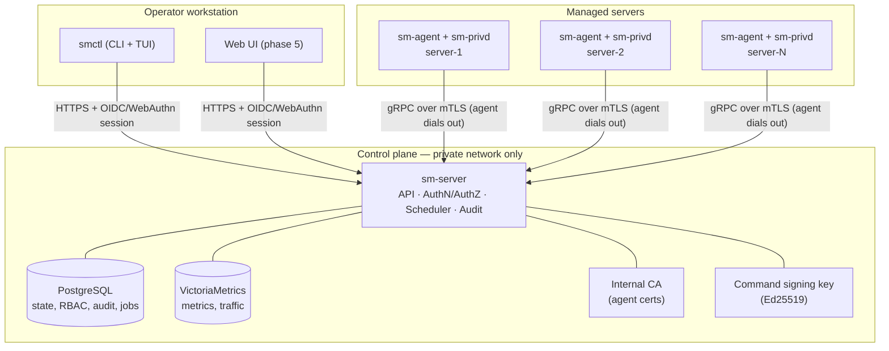
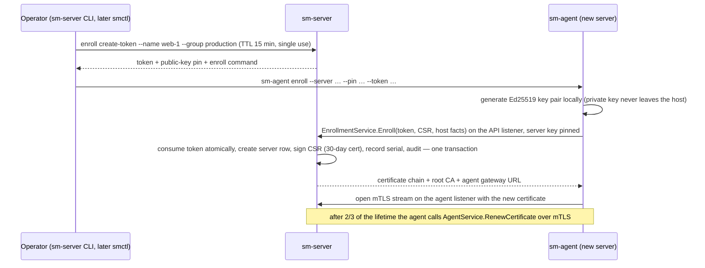
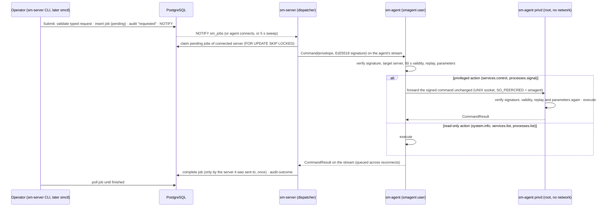

# Server Manager — Architecture

Status: **v0.2** (Phase 0 implemented) · Owner: project maintainer · Last updated: 2026-11-19

A self-hosted, console-first platform for managing a fleet of Linux cloud servers
from a single point: monitoring, Docker, databases, services, processes, firewall,
banned IPs, audit logs, traffic, disk, swap, timezone, security posture and domains.

---

## 1. Goals and non-goals

### Goals

| # | Goal | What it means in practice |
|---|------|---------------------------|
| G1 | **Secure by default** | No inbound management port on managed servers. mTLS everywhere. MFA for humans. Every action is authorized and audited. |
| G2 | **Efficient** | Agent ≤ 30 MB RSS and < 1 % CPU when idle. One long-lived connection per server. Binary protobuf transport. |
| G3 | **Single point of control** | One CLI/TUI (and later a web UI) for every server, with server groups and bulk actions. |
| G4 | **Safe operations** | Typed actions only, dry-run first, confirmation for risky actions, automatic rollback where a mistake could lock you out (firewall, SSH, network). |
| G5 | **Simple to run** | Control plane is a single binary + PostgreSQL + VictoriaMetrics. Agent is one static binary installed as a systemd service. |

### Non-goals (for v1)

- Not a configuration-management tool (no Ansible/Puppet-style desired-state engine).
- Not a cloud-provider console (no creating VMs on AWS/GCP/Hetzner — may come later through provider APIs).
- No Windows or macOS agents. Linux with systemd only.
- No multi-tenant SaaS. One organization per installation.

### Supported server platforms (v1)

Ubuntu 22.04 / 24.04, Debian 12 / 13, RHEL 9 and derivatives (Rocky, Alma). `amd64` and `arm64`.

---

## 2. System overview



The control plane runs on a small, **always-on cloud VM**; operators run `smctl` on their
own Windows, macOS or Linux workstation (see [REQUIREMENTS.md](REQUIREMENTS.md) §1). Managed
servers expose no management port. The **agent gateway** may face the internet because it
accepts only recorded mTLS client certificates; the **operator API** stays on a private
network (WireGuard, Headscale/Tailscale) or behind an IP allowlist (ADR 0009).

### Components

| Component | Binary | Runs on | Responsibility |
|-----------|--------|---------|----------------|
| Control plane | `sm-server` | 1 management host (HA later) | Public API for operators, agent gateway, authentication, RBAC, job scheduling, audit log, alerting, PKI. |
| Agent | `sm-agent` | Every managed server, unprivileged user `smagent` | Keeps the connection to the control plane, collects metrics and logs, runs read-only modules, forwards privileged actions to `sm-privd`. |
| Privileged helper | `sm-privd` | Every managed server, root, local only | Runs a fixed, typed set of privileged actions (firewall, swap, services, packages …). No network access; listens only on a local UNIX socket. |
| Console | `smctl` | Operator workstation (Windows, macOS, Linux) | CLI for scripting and a full-screen TUI for interactive use. |
| Web UI | (phase 5) | Browser | Same API as `smctl`. |

`sm-agent` and `sm-privd` ship as **one binary** with two subcommands and two
systemd units, so there is one file to install and update.

---

## 3. Agent ↔ control-plane communication

### 3.1 Transport

- **ConnectRPC** (gRPC-compatible) over HTTP/2 with **mutual TLS 1.3**.
  ConnectRPC speaks gRPC to agents and JSON/HTTP to browsers from the same
  handlers, which keeps the web UI simple later.
- The **agent always dials out**. One bidirectional stream per agent carries:
  heartbeats, metric batches, log/event batches, commands (control plane → agent),
  and command results / progress (agent → control plane).
- Reconnects use exponential back-off with jitter (1 s → 60 s cap).
- Metrics and events are buffered on disk on the agent (bounded ring buffer, 50 MB
  default) while disconnected, then replayed.

### 3.2 Enrollment and certificate lifecycle



- **Where:** enrollment is served on the API listener (server TLS only), because a new
  agent has no client certificate yet. The agent listener accepts nothing without a
  valid client certificate.
- **Trust on first contact:** the agent verifies the control plane by the SHA-256 of its
  public key (printed with the token), not by a CA it does not have yet. A wrong pin
  aborts before the token is sent. After enrollment the agent checks that the pinned
  certificate chains to the CA it received.
- **Tokens:** 32 random bytes with an `smenr_` prefix; only the SHA-256 is stored. A token
  names the server and group it enrolls, so an agent cannot choose its identity. Failed
  attempts are rate-limited per IP and audited without revealing why they failed.
- **Every issued certificate is recorded.** A certificate whose serial is not in
  `agent_certificates` is rejected even if the CA signed it, so a leaked intermediate
  key cannot mint working agent certificates without database access too.
- **Revocation** (`sm-server servers revoke`) marks the server and its certificates
  revoked. New TLS handshakes and new streams are refused immediately (the check runs
  per handshake and per stream, because HTTP/2 reuses connections); an open stream is
  closed at its next heartbeat. Streams also end when the certificate that opened them
  expires.
- **Renewal** keeps the agent's key and replaces only the certificate file (atomic
  rename). The control plane renews only certificates past half their lifetime. The
  agent then reconnects so the new certificate is used. An expired certificate cannot be
  renewed; the server must be re-enrolled.

### 3.3 Command flow



- **Durable queue:** jobs live in PostgreSQL. A job for an offline server waits until
  the agent connects (default 10 minutes, then `expired`). The command is signed at
  dispatch time, so its 60-second validity starts when it is actually sent.
- **No blind retries:** a dispatched job without a result after 2 minutes is marked
  `failed` with "outcome unknown". It is never re-sent, because a restart or kill may
  already have happened.
- **Signature checked twice:** the privileged helper verifies the control plane's
  signature itself, with its own replay cache. A compromised network-facing agent can
  therefore ask the helper for nothing that the control plane did not sign.
- **Command key:** a separate Ed25519 key (`pki_dir/command.key`) created on first start.
  Agents receive the public key at enrollment. Agents enrolled earlier store the key
  the first time they see it in `Welcome` (over the authenticated stream) and refuse a
  different key afterwards.

**Why sign commands when mTLS already authenticates the channel?** Defense in
depth. The signing key is separate from the TLS key and can live in a KMS/HSM later.
Signatures with a short expiry and a unique ID stop replay, and the privileged helper,
which never touches the network, can verify the origin of every command on its own.

### 3.4 Metrics

- The agent collects CPU (from `/proc/stat` deltas), load, memory, swap, uptime,
  filesystems and per-interface network counters and rates every 15 s and pushes a
  `MetricsBatch` on its stream.
- While disconnected, batches are kept in a bounded in-memory buffer (default 480
  batches, two hours) and sent oldest-first after reconnecting. The buffer survives
  disconnects but not an agent restart.
- The control plane validates each batch (time window, label sizes, counts), upserts the
  latest snapshot per server into PostgreSQL (`server_metrics`, used by the dashboard;
  late batches never overwrite newer ones) and, when `victoriametrics_url` is set, queues
  the samples for VictoriaMetrics' Prometheus text import with retry and bounded memory.
- Metric names: `sm_cpu_percent`, `sm_load1|5|15`, `sm_memory_total_bytes`,
  `sm_memory_available_bytes`, `sm_swap_*`, `sm_uptime_seconds`,
  `sm_filesystem_size_bytes` / `sm_filesystem_avail_bytes` {mount, fstype},
  `sm_network_{receive,transmit}_{bytes,errors}_total` {interface}; all carry `server_id`.

---

## 4. Action model

Everything an operator can do is a **typed action** defined in protobuf. The agent
has no "run this shell string" endpoint in normal operation.

```protobuf
// Example
message ServiceRestartRequest {
  string unit = 1;  // validated: ^[a-zA-Z0-9@._-]+\.service$
}
```

Each action declares:

| Property | Values | Effect |
|----------|--------|--------|
| `privilege` | `unprivileged` / `privileged` | Privileged actions run in `sm-privd`. |
| `risk` | `read` / `low` / `medium` / `high` / `critical` | Drives RBAC, confirmation prompts and step-up MFA. |
| `supports_dry_run` | bool | Dry run shows the exact change without applying it. |
| `rollback` | none / automatic / manual | E.g. firewall changes roll back automatically if not confirmed. |
| `idempotency` | bool | Safe to retry after a lost result. |

Risk handling:

| Risk | Example | Requirement |
|------|---------|-------------|
| read | list containers, view metrics | `viewer` role |
| low | restart a container, clean apt cache | `operator` role |
| medium | stop a service, kill a process, change swap | `operator` + typed confirmation |
| high | firewall rule change, ban/unban IP ranges, DB user changes | `admin` + step-up MFA |
| critical | drop database, delete volumes, interactive shell | `admin` + step-up MFA + reason text; optional second approver |

### Safety rollback (example: firewall)

1. `sm-privd` saves the current nftables ruleset.
2. Applies the new ruleset.
3. Starts a 90-second timer.
4. The control plane must confirm over a **new** connection that the agent is still
   reachable. If confirmation does not arrive, `sm-privd` restores the saved ruleset.

The same pattern is used for SSH daemon config and network changes.

### Break-glass shell

An interactive shell is available only as a `critical` action: disabled by
default per server group, time-limited (15 min), fully recorded (asciinema-style
cast stored with the audit event) and announced to other admins.

---

## 5. Security model

### 5.1 Threats considered

| Threat | Mitigation |
|--------|------------|
| Attacker scans managed servers for a management port | Agents listen on nothing. `sm-privd` uses a local UNIX socket only. |
| Stolen operator password | OIDC or local accounts with mandatory WebAuthn (preferred) or TOTP. Short sessions (8 h, idle 30 min). |
| Stolen operator laptop/session | Step-up MFA for high/critical actions, session revocation, device-bound refresh tokens. |
| Compromised agent on one server | Its certificate is valid for its own identity only; it cannot read other servers' data or send commands. Revoke in one step. |
| Compromised control plane database | Command-signing key not stored in the DB (file with strict permissions or KMS). Secrets encrypted at rest (envelope encryption). |
| Command injection through parameters | Typed protobuf params, regex/enum validation in both agent and helper, `exec` with argument arrays — never through a shell. |
| Replay of captured commands | Signature + 60 s expiry + nonce cache on agent. |
| Insider covering their tracks | Append-only, hash-chained audit log; optional streaming copy to external storage (S3 object-lock, syslog). |
| Malicious update of the agent | Release binaries signed with cosign; agent verifies signature and checksum before self-update. |
| Supply-chain vulnerabilities | `govulncheck`, Dependabot/Renovate, SBOM per release, minimal dependencies. |

### 5.2 Authentication and authorization

- **Humans (implemented):** local accounts with Argon2id password hashes (RFC 9106
  parameters) and **mandatory TOTP** (RFC 6238). TOTP secrets are encrypted at rest with
  AES-256-GCM using `pki_dir/secrets.key`, bound to the user ID. Each TOTP time step is
  accepted once per user (atomic check), so a seen code cannot be replayed.
- **Login protection:** one generic error for unknown accounts, wrong passwords, wrong
  codes, disabled and locked accounts; unknown accounts still run Argon2id so timing
  does not reveal them; per-IP rate limit; lockout for 15 minutes after 5 failures. All
  attempts are audited.
- **Sessions:** 32-byte bearer tokens (`smses_…`, only the SHA-256 stored), 8 h absolute
  and 30 min idle lifetime, revoked on logout, credential reset or account disable.
  `smctl` stores the token in a 0600 file (`~/.config/smctl/session.json`).
- **Step-up:** high- and critical-risk actions (revoking a server, creating enrollment
  tokens) need a TOTP check from the last 5 minutes; the API marks such errors with an
  `Sm-Step-Up` header and `smctl` prompts for a code and retries.
- **Agents:** mTLS client certificates issued by the internal CA. Certificate
  subject = server UUID.
- **RBAC (implemented):** roles `viewer` < `operator` < `admin` < `owner`, bound per
  server group or for all servers. viewer: read actions; operator: low and medium;
  admin: high (+ step-up), the audit log (global admin) and enrollment; owner: critical.
  Servers outside a user's groups are reported as not found.
- **Bootstrap:** the first accounts are created on the control-plane host with
  `sm-server users create`; there is no default account.
- **Later:** OIDC login, OAuth device-code flow for the CLI with tokens in the OS
  keyring, WebAuthn, custom roles, and scoped API tokens for automation.

### 5.3 Agent hardening

- `sm-agent` runs as `smagent` with systemd sandboxing: `NoNewPrivileges=yes`,
  `ProtectSystem=strict`, `ProtectHome=yes`, `PrivateTmp=yes`,
  `RestrictAddressFamilies=AF_UNIX AF_INET AF_INET6 AF_NETLINK`,
  `SystemCallFilter=@system-service`.
- `sm-privd` runs as root but has **no network access**
  (`IPAddressDeny=any`, `RestrictAddressFamilies=AF_UNIX AF_NETLINK`), accepts
  connections only from the `smagent` UID (checked with `SO_PEERCRED`), and exposes
  only the typed privileged actions.
- **Docker socket caveat:** access to `/var/run/docker.sock` equals root. Docker
  calls therefore go through `sm-privd`, never directly from `sm-agent`.
- **Trust anchors are root-owned:** `sm-privd` verifies commands with the control
  plane's key and this server's identity from `/etc/sm-agent-trust`, written by
  enrollment as root. It refuses them unless the files and every directory above them
  are owned by root and not writable by group or others, and it never reads the
  agent's own directory (`/etc/sm-agent`, which the agent must be able to write for
  certificate renewal). Otherwise a compromised agent could plant its own command key
  and sign privileged commands.

### 5.4 Audit log

Every request writes an event: actor, auth method, source IP, server(s), action,
parameters (secrets redacted), risk, result, duration, and
`hash = SHA-256(previous_hash || event)`. A daily job verifies the chain and alerts
on any break. On-server security events (SSH logins, sudo, `auditd`) are collected
into the same store so one search covers both "what did operators do" and "what
happened on the server".

### 5.5 Secrets

Database passwords, DNS-provider tokens and similar are encrypted with a data key,
which is encrypted with a master key (file, `age` identity, or cloud KMS). Secrets
are decrypted only at the moment they are sent to an agent and are never logged.

---

## 6. Feature modules

Each module is a Go package implementing the same interface on the agent side
(`Describe()`, `Collect()`, `Handle(action)`) plus a matching service on the control
plane. Modules can be disabled per server group.

| Module | Data source / mechanism | Example actions | Max risk |
|--------|-------------------------|-----------------|----------|
| **system** (dashboard) | `/proc`, `/sys`, gopsutil | host facts, CPU/RAM/disk/load/uptime | read |
| **services** | systemd over D-Bus (`go-systemd`) | list, status, start/stop/restart, enable/disable, unit logs | medium |
| **processes** | `/proc` | list, tree, top, send signal | medium |
| **logs / audit** | journald API, `/var/log/auth.log`, `auditd` | search, tail, SSH-login history, sudo history | read |
| **docker** | Docker Engine API (via `sm-privd`) | containers, images, volumes, networks, logs, stats, start/stop, prune | critical (volume delete) |
| **database** | MySQL/MariaDB/PostgreSQL over local socket | list DBs/users, create user/DB, grant, backup/restore, slow queries | critical (drop) |
| **traffic** | `/proc/net/dev`, nftables counters, conntrack; eBPF later | per-interface rates, top talkers, monthly totals | read |
| **firewall** | nftables (`google/nftables`); ufw/firewalld adapters | list, add/remove rule, default policy, with auto-rollback | high |
| **banned IPs** | CrowdSec (preferred) or fail2ban | list bans, ban/unban, fleet-wide blocklist | high |
| **time** | `org.freedesktop.timedate1` over D-Bus | timezone, NTP on/off, clock status | low |
| **disk** | statfs, `du`-style walker, package managers | usage, largest files, journal vacuum, package cache, old kernels, Docker prune (dry-run first) | medium |
| **swap** | `swapon`, `/etc/fstab`, `vm.swappiness` | create/resize/remove swapfile, tune swappiness | medium |
| **security** | built-in checks + optional Lynis | SSH config audit, pending updates, open ports, SUID changes, score per server | read / low |
| **updates** | apt / dnf | list pending, install security updates, reboot-required | medium |
| **domains & TLS** | Caddy or Nginx config + ACME (`lego`), DNS-provider APIs | add domain/vhost, issue/renew cert, DNS records, expiry alerts | high |
| **alerts** | control plane rule engine | thresholds (disk > 90 %, cert expiry < 14 d, agent offline), notify Telegram/e-mail/Slack/webhook | — |

---

## 7. Data model (PostgreSQL)

Core tables (simplified):

```
users(id, email, name, auth_provider, mfa_required, created_at, disabled_at)
webauthn_credentials(id, user_id, public_key, sign_count, created_at)
roles(id, name, permissions jsonb)
role_bindings(user_id, role_id, server_group_id)
api_tokens(id, user_id, hash, scopes jsonb, expires_at)

server_groups(id, name, settings jsonb)          -- module toggles, shell policy
servers(id uuid, name, group_id, hostname, os, arch, agent_version,
        labels jsonb, last_seen_at, status)
agent_certificates(serial, server_id, not_after, revoked_at)
enrollment_tokens(id, hash, group_id, expires_at, used_at, created_by)

jobs(id, actor_id, server_id, module, action, params jsonb, risk,
     status, created_at, started_at, finished_at, result jsonb)
audit_events(id bigserial, ts, actor, source_ip, server_id, action,
             params_redacted jsonb, result, prev_hash, hash)

alert_rules(id, group_id, expr, severity, channels jsonb)
alerts(id, rule_id, server_id, state, started_at, resolved_at)
secrets(id, name, ciphertext, data_key_ciphertext, created_at)
domains(id, server_id, fqdn, webserver, cert_not_after, dns_provider_id)
```

Time-series data (CPU, memory, disk, network, container stats) goes to
**VictoriaMetrics** through its Prometheus remote-write API. It uses much less RAM
and disk than Prometheus/TimescaleDB for this workload, and existing Grafana
dashboards can read it if wanted.

Migrations: `goose`. Queries: `sqlc` (type-safe generated Go, no ORM).

---

## 8. Repository layout

```
server-manager/
├── api/proto/sm/             # protobuf sources (buf module)
│   ├── agent/v1/             #   agent ↔ control-plane stream
│   └── operator/v1/          #   operator API (CLI, web UI)
├── gen/                      # generated Go code from api/proto (committed, checked in CI)
├── cmd/
│   ├── sm-server/            # control plane
│   ├── sm-agent/             # agent + `sm-agent privd` subcommand (phase 1)
│   └── smctl/                # CLI + TUI
├── internal/
│   ├── pki/                  # internal CA, CSR signing, agent identity, revocation (shared)
│   ├── agent/                # connection, buffering, module registry
│   │   └── modules/          # system, services, docker, firewall, …
│   ├── privd/                # privileged helper server + action handlers
│   ├── server/
│   │   ├── api/              # operator API handlers
│   │   ├── gateway/          # agent stream gateway + connected-agent registry
│   │   ├── auth/             # OIDC, WebAuthn, TOTP, sessions, API tokens
│   │   ├── rbac/
│   │   ├── audit/
│   │   ├── jobs/
│   │   ├── alerts/
│   │   └── store/            # goose migrations, sqlc queries, generated db package
│   ├── ctl/                  # smctl commands and TUI views
│   └── pkg/                  # shared helpers (config, logging, version)
├── tools/                    # separate Go module pinning buf, sqlc, protoc plugins, govulncheck
├── deploy/
│   ├── systemd/              # unit files for agent, privd, server
│   ├── compose/              # docker compose for PostgreSQL + VictoriaMetrics
│   ├── dev/                  # development configuration files
│   └── install/              # agent install script
├── docs/                     # architecture, plan, ADRs, development guide, runbooks
├── test/e2e/                 # VM-based end-to-end tests
├── buf.yaml / buf.gen.yaml / sqlc.yaml
├── .goreleaser.yaml
└── Makefile
```

---

## 9. Technology choices

| Area | Choice | Reason |
|------|--------|--------|
| Language | **Go** (latest stable) | Static binaries, low memory, strong concurrency, best ecosystem for systemd/Docker/netlink. One language for agent, server and CLI. |
| RPC | **ConnectRPC** + protobuf, managed with **buf** | gRPC on the wire for agents, JSON for browsers, breaking-change detection in CI. |
| Database | **PostgreSQL 16+**, `pgx`, `sqlc`, `goose` | Reliable, transactional audit log, no ORM magic. |
| Metrics | **VictoriaMetrics** (single-node) | Efficient storage, PromQL-compatible. |
| CLI / TUI | **Cobra** + **Bubble Tea / Lip Gloss** | Scriptable commands plus a fast full-screen UI. |
| Auth | `coreos/go-oidc`, `go-webauthn/webauthn`, `pquerna/otp` | Maintained, standards-based libraries. |
| System access | `coreos/go-systemd`, `godbus/dbus`, `google/nftables`, `shirou/gopsutil`, Docker Go SDK | Native APIs instead of parsing shell output. |
| Logging | `log/slog` (JSON) | Standard library, structured. |
| Packaging | **GoReleaser** + nFPM (.deb/.rpm) + **cosign** | Signed, reproducible releases with SBOMs. |
| Private network | WireGuard / Headscale | Keeps the control plane off the public internet. |

---

## 10. Deployment

**Control plane (single node, v1):**
`docker compose` with `sm-server`, PostgreSQL and VictoriaMetrics, or the same three
as systemd services. Daily `pg_dump` + VictoriaMetrics snapshot to off-site storage.
Sizing guide: 2 vCPU / 4 GB RAM handles roughly 200 servers at 15 s metric intervals.

**Agent install:** `smctl enroll create-token` prints a one-line command for
`install-agent.sh`, which downloads the `.deb`/`.rpm` from the release, checks its
SHA-256 against the release's `checksums.txt` (and the cosign signature when `cosign` is
installed), installs it, enrolls with the token and starts the two units. The packages
create the `smagent` user and `/etc/sm-agent`. Details in [INSTALL.md](INSTALL.md).

**Upgrades:** the control plane offers new agent versions; agents download, verify
the cosign signature and restart through systemd. Staged roll-out by server group.

**High availability (later):** multiple `sm-server` replicas behind a TCP load
balancer, PostgreSQL with streaming replication, agents reconnect to any replica,
command routing through PostgreSQL `LISTEN/NOTIFY`.

---

## 11. Observability of the platform itself

- `sm-server` and `sm-agent` expose Prometheus metrics (connections, command
  latency, queue depth, buffer fill, errors) into the same VictoriaMetrics.
- Structured JSON logs with request/job IDs that match audit events.
- `smctl doctor` checks connectivity, certificate expiry, clock skew and versions.

---

## 12. Architecture decisions (summary)

Full ADRs: [`docs/adr/`](adr/README.md).

| ADR | Decision | Main alternative rejected | Why |
|-----|----------|---------------------------|-----|
| 001 | Agent-based, outbound-only connection | Agentless over SSH | No inbound ports, real-time streams, no master SSH key. |
| 002 | Go for all components | Rust agent + Python server | One language, fast delivery, small static binaries; Rust's extra safety not worth the slower development here. |
| 003 | Privilege split (`sm-agent` / `sm-privd`) | Single root agent | A network-facing process should not run as root. |
| 004 | Typed actions only, shell is break-glass | Generic remote shell | Prevents a compromised console from running arbitrary commands. |
| 005 | ConnectRPC | Plain gRPC + grpc-gateway | One handler set serves both gRPC and browser JSON. |
| 006 | PostgreSQL + VictoriaMetrics | Single TimescaleDB | Keeps relational and time-series workloads separate and cheap. |
| 007 | nftables as primary firewall backend | iptables | Modern kernel default, atomic ruleset replacement makes rollback reliable. |
| 008 | CrowdSec preferred over fail2ban | fail2ban only | Fleet-wide shared decisions; fail2ban kept as adapter. |
