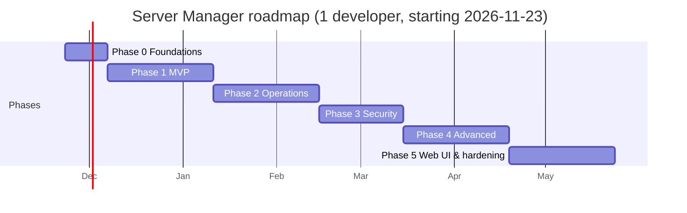

# Server Manager — Development Plan

Status: **Draft v0.1** · Last updated: 2026-11-19 · Companion to [ARCHITECTURE.md](ARCHITECTURE.md)

Estimates assume **one full-time developer**. With two developers most phases
shrink by about 40 % (agent modules and control-plane/CLI work run in parallel).
Every phase ends with a tagged release that is usable on real servers.

---

## 1. Roadmap at a glance

| Phase | Name | Duration | Release | Outcome |
|-------|------|----------|---------|---------|
| 0 | Foundations | 2 weeks | `v0.0.x` | Repo, CI, protobuf, PKI, dev environment |
| 1 | MVP: connect, observe, control | 5 weeks | `v0.1.0` | Enroll servers, live dashboard, services, processes, logs, audit, CLI |
| 2 | Operations | 5 weeks | `v0.2.0` | Docker, disk cleanup, swap, timezone, updates, TUI, control-plane deployment and workstation onboarding |
| 3 | Security | 4 weeks | `v0.3.0` | Firewall with rollback, banned IPs, security checks, alerts, MFA step-up |
| 4 | Advanced | 5 weeks | `v0.4.0` | Databases, domains & TLS, traffic analytics, backups, secrets |
| 5 | Web UI & hardening | 5 weeks | `v1.0.0` | Web UI, external security review, packaging, docs |

**Total: about 25 weeks (≈ 6 months) to v1.0.**

---

## 2. Phase details

### Phase 0 — Foundations (2 weeks) — ✅ done

**Goal:** everything needed to build features quickly and safely.

| # | Task | Done when | Status |
|---|------|-----------|--------|
| 0.1 | Go module, repo layout from the architecture doc, `Makefile` | `make build` produces `sm-server`, `sm-agent`, `smctl` | ✅ |
| 0.2 | `buf` setup, first protos (`agent/v1` stream, `operator/v1` health) | `buf lint` and `buf breaking` run in CI | ✅ |
| 0.3 | CI (GitHub Actions): build, `go test -race`, `golangci-lint`, `gosec`, `govulncheck` | Green pipeline on every PR | ✅ workflow written; first run happens on the PR |
| 0.4 | Dev environment: `docker compose` with PostgreSQL + VictoriaMetrics, 2–3 test VMs (Multipass/Incus) | `make dev-up` starts everything | ✅ compose; VM setup documented in [DEVELOPMENT.md](DEVELOPMENT.md) |
| 0.5 | Store layer: `goose` migrations, `sqlc` config, base tables (servers, users, audit_events) | Migrations apply and roll back cleanly | ✅ plus DB-enforced append-only audit table |
| 0.6 | Internal CA package: create root/intermediate, sign CSR, issue server cert | Unit tests for issuance, expiry, revocation | ✅ |
| 0.7 | Config loading (file + env), `slog` logging, version info | `--version` and `--config` work in all binaries | ✅ |
| 0.8 | ADRs 001–008 written in `docs/adr/` | Reviewed and merged | ✅ written, review pending |

**Exit criteria:** CI green; a hello-world mTLS stream between a test agent and the server works.

**Result:** `internal/server/server_test.go` runs a real control plane and agent over loopback
mTLS (hello → welcome → acknowledged heartbeats) and checks that clients without a
certificate and revoked agents are rejected. Measured agent footprint while connected:
13.5 MB RSS, ~0 % CPU.

**Carried into Phase 1:** revocation is in memory only (task 1.1 moves it to the
database); agents are enrolled manually with `sm-agent keygen` + `sm-server pki sign-agent`
until token enrollment (task 1.1) exists.

---

### Phase 1 — MVP: connect, observe, control (5 weeks)

**Goal:** manage real servers from the CLI with full audit.

| # | Task | Done when | Status |
|---|------|-----------|--------|
| 1.1 | Enrollment flow (token → CSR → cert, fingerprint pinning) | `smctl server add` prints an install command; new server shows as online | ✅ `smctl enroll create-token` + `sm-agent enroll` |
| 1.2 | Agent stream: heartbeat, reconnect with back-off, on-disk buffer | Killing the network for 10 min loses no metrics | ✅ 2 h in-memory buffer, sent oldest-first after reconnect (survives disconnects, not agent restarts; on-disk spool later if needed) |
| 1.3 | Command dispatch: job table, signing, expiry, nonce, result streaming | Commands survive agent reconnects; replayed commands are rejected | ✅ jobs queue + NOTIFY, Ed25519 signing, replay/expiry checks, results queued across reconnects |
| 1.4 | `sm-privd` helper: UNIX socket, `SO_PEERCRED` check, typed action registry | Agent-to-helper calls work; any other UID is refused | ✅ `sm-agent privd`; also re-verifies the control-plane signature |
| 1.5 | Module **system**: host facts + CPU/RAM/disk/load metrics to VictoriaMetrics | `smctl dashboard` shows live numbers for all servers | ✅ 15 s metrics push, latest snapshot in PostgreSQL, history to VictoriaMetrics; `smctl dashboard --watch` |
| 1.6 | Module **services** (systemd D-Bus): list, status, start/stop/restart, enable/disable | Restarting `nginx` from the CLI works and is audited | 🟡 implemented and tested with a fake systemd; real D-Bus to be verified in VMs (1.12) |
| 1.7 | Module **processes**: list, tree, top-N, signal | `smctl proc top srv-1` and `smctl proc kill` work | ✅ list/top-N/signal (with PID-reuse protection) via `smctl processes`; tree view later |
| 1.8 | Module **logs**: journald query/tail, SSH-login and sudo history | `smctl logs srv-1 --unit nginx --follow` works | ✅ `smctl logs web-1 --unit nginx --follow` (cursor polling every 2 s) and `smctl logins` |
| 1.9 | Authentication: local accounts (Argon2id) + TOTP, CLI device-code login, sessions | Login without MFA is impossible | ✅ Argon2id + mandatory TOTP, sessions, lockout, step-up; `smctl login` asks for password and code directly (device-code flow and OS keyring later) |
| 1.10 | RBAC: built-in roles per server group | `viewer` cannot restart services (test) | ✅ viewer/operator/admin/owner per group or global; tested end to end |
| 1.11 | Audit log with hash chain + `smctl audit` search + chain verify job | Tampering with a row is detected | 🟡 hash chain, tamper detection, `smctl audit list`, `sm-server audit verify`; scheduled verify job pending |
| 1.12 | systemd units with sandboxing, install script, `.deb`/`.rpm` via GoReleaser | Fresh Ubuntu 24.04 and Rocky 9 VMs enroll with one command | ✅ `.deb`/`.rpm` via nFPM, `install-agent.sh`, signed release workflow; system tests install and drive the packages in systemd containers on Ubuntu 24.04 and Rocky 9 (containers instead of VMs, see below) |

Notes on 1.12: packages are built with nFPM directly (`make packages`) rather than
GoReleaser, and the end-to-end tests run in systemd containers (`make system-test`)
because they are reliable on CI runners and on developer machines with Docker. They
exercise real systemd, D-Bus, journald, the unit sandboxing and the maintainer scripts.
Full VMs (Incus/Multipass) remain useful for kernel-level checks such as the firewall
module in Phase 3.

Also done in the first Phase 1 slice (needed for 1.1 to be usable in production):
database-backed revocation (every issued certificate is recorded; unknown serials are
rejected), automatic certificate renewal, server status tracking (online/offline/revoked
with host facts), and stream termination on revocation or certificate expiry.

**Exit criteria (v0.1.0):**
- Enroll 3 servers, view dashboard, restart a service, kill a process, tail logs — all from `smctl`.
- No listening TCP port on managed servers (`ss -tlnp` check in e2e tests).
- Agent idle: < 30 MB RSS, < 1 % CPU (measured).

---

### Phase 2 — Operations (4 weeks)

| # | Task | Done when | Status |
|---|------|-----------|--------|
| 2.1 | Module **docker**: containers, images, volumes, networks, logs, stats, start/stop/restart, remove, prune (via `sm-privd`) | Full container lifecycle from the CLI; container stats in dashboard | ✅ `smctl docker ps/start/stop/restart/rm/logs/stats/images/volumes/networks/prune`, all in the privileged helper; running containers and their memory in `smctl dashboard` |
| 2.2 | Module **disk**: usage per mount, largest files/dirs, cleanup tasks (journal vacuum, package cache, old kernels, Docker prune) with dry-run | Dry run shows the bytes to be freed; apply frees them | ⏳ |
| 2.3 | Module **swap**: create/resize/remove swapfile, fstab update, swappiness | Swap survives reboot; removal is clean | ✅ `smctl swap status/create/resize/remove/swappiness`; one managed swapfile activated by a systemd swap unit (systemd does swapon, so no `CAP_SYS_ADMIN`); swappiness persisted in `/etc/sysctl.d` |
| 2.4 | Module **time**: timezone, NTP status/toggle (timedate1 D-Bus) | Bulk-set timezone on a server group | ✅ `smctl time set-timezone --group staging Europe/Berlin`, `smctl time ntp`, `smctl time status` (timedated over D-Bus) |
| 2.5 | Module **updates**: pending packages, security-only install, reboot-required flag | `smctl updates apply --security --group staging` | ⏳ |
| 2.6 | Bulk actions on server groups/labels with concurrency limit and per-server results | Restart a service on 20 servers, 5 at a time | ✅ `smctl services restart --group staging nginx --parallel 5` (also `--all` and `web-1,web-2`); per-server output and a summary; labels follow once servers can be labelled |
| 2.7 | **TUI** (`smctl ui`): fleet overview, server detail, services, processes, containers, logs | All phase 1–2 features usable without typing commands | ⏳ |
| 2.8 | Confirmation prompts by risk level (typed server name for medium+) | Cannot accidentally prune volumes | ✅ medium+ asks for the server name (group name, or server count for lists and `--all`); `--yes` for scripts; refused without a terminal |
| 2.9 | Production compose bundle for the control plane (sm-server + PostgreSQL + VictoriaMetrics) and a "small VM" quickstart | One command brings up a control plane on a fresh cloud VM ([REQUIREMENTS](REQUIREMENTS.md) N-03) | ⏳ |
| 2.10 | Enrollment reachable by new servers while the operator API stays private (separate listener or unauthenticated path on the agent port) | New servers enroll with :8444 closed to the internet (N-02, ADR 0009) | ⏳ |
| 2.11 | `smctl login --pin` (trust on first use like `sm-agent enroll`) and named contexts for several control planes | Laptop onboarding without copying `root.crt`; switch staging/production with one flag (W-02, W-03) | ⏳ |
| 2.12 | Windows console polish: no password echo under Git Bash/mintty, virtual-terminal mode for `--watch` in legacy consoles | Login and dashboard work in Windows Terminal, PowerShell, cmd and Git Bash (W-04, W-05) | ⏳ |

Notes on 2.6: bulk runs are orchestrated by `smctl` (`internal/ctl/bulk.go`) on top of
the existing `ActionService.Run`, so every server still gets its own job, RBAC check,
signature and audit record, and the control plane gained no new endpoint. The first
server runs alone (a step-up prompt is answered once, and it acts as a canary), then up
to `--parallel` (default 5, max 20) at a time. Offline servers are skipped unless
`--include-offline`; an explicitly listed server you cannot see is an error rather than
silently dropped.

Notes on 2.1: the Docker socket is root-equivalent, so every `docker.*` action, reads
included, runs in `sm-privd`, which re-verifies the signed command first. The helper
talks to the Engine API over `/run/docker.sock` with a small built-in client (no Docker
SDK dependency) that negotiates the API version between 1.41 and 1.47, so it works with
Docker 20.10 through 29+. Container references are names or hex IDs only; changes
need the exact name or at least 12 characters of the ID (no silent short-prefix match)
and act on the full ID resolved first. Risk: list/logs/stats read; start/restart low;
stop and prune of images (dangling), networks and build cache medium; `rm`, prune of
stopped containers and of all unused images high; `rm --volumes` and volume prune
critical (volume prune on API < 1.42 is refused because it would also delete named
volumes). Results over 768 KiB are failed by the agent instead of sent (the stream
limit is 1 MiB), lists stop at a byte budget, and `smctl` strips terminal control and
bidi characters from everything it prints from a server. The
dashboard's container count and memory come from cgroupfs, read by the unprivileged
agent without touching the socket. Not covered yet: a system test with a real Docker
daemon (the systemd test containers do not run Docker); the Engine API handling is
tested against a fake daemon.

Security fix after 2.1: `sm-privd` used to load the command key and the server identity
from `/etc/sm-agent`, which belongs to the agent, so a compromised agent could have
replaced the key and signed its own privileged commands. The helper's trust anchors now
live in root-owned `/etc/sm-agent-trust` (checked for ownership and permissions up to
`/`), the agent never writes the key (no more trust on first use from the stream),
`CAP_DAC_READ_SEARCH` was dropped from the helper, and upgrades migrate with
`sm-agent migrate-trust` at most once per host (it reads the agent's files without
following symlinks and never replaces an existing trust key). The trust files are read
through the path that was checked, must be small regular files, and are written through
exclusively created temporary files into a directory the writer controls.

Notes on 2.3/2.4: the helper manages only `/var/lib/smswap/swapfile` (fixed path, never
caller-supplied); other swap devices are shown but never changed. It writes only its
state directory: the package ships the swap unit (`var-lib-smswap-swapfile.swap`,
conditional on the file existing) and links `/etc/sysctl.d/90-sm-swappiness.conf` into
`/var/lib/smswap`, and the helper enables/starts the unit over D-Bus, so systemd does
swapon and the helper needs neither `CAP_SYS_ADMIN` nor write access to `/etc`. It writes
the swap header itself (no `mkswap`), refuses filesystems other than ext4/xfs, keeps the
larger of 1 GiB and 10 % of the filesystem free, checks space before a resize tears
anything down, undoes a create whose activation fails, serialises swap changes, and
refuses to turn swap off when the swapped-out memory would not fit in RAM. Swappiness is
applied by restarting `systemd-sysctl` and then verified; if it does not take effect the
operator is told it is only saved. Turning NTP off is medium risk (drifting clocks break
signed commands). The system tests run on overlayfs in containers without
systemd-sysctl, so they check the clean refusals there; activation is covered by unit
tests with a fake systemd.

Planned order for the rest of the phase: disk
(2.2–2.4), updates (2.5), control-plane deployment and workstation onboarding
(2.9–2.12), then the TUI (2.7) on top of all of them.

**Exit criteria (v0.2.0):** daily server operations done entirely through `smctl`/TUI.

---

### Phase 3 — Security (4 weeks)

| # | Task | Done when |
|---|------|-----------|
| 3.1 | Module **firewall** (nftables): list, add/remove rules, default policies, port presets | Rules applied atomically |
| 3.2 | Firewall **auto-rollback** (save → apply → confirm on new connection within 90 s → else restore) | E2E test: a rule that blocks the agent is reverted automatically |
| 3.3 | ufw / firewalld adapters (read + basic rules) for servers that already use them | Existing ufw setup is shown correctly, not overwritten |
| 3.4 | Module **banned IPs**: CrowdSec integration (decisions list/add/delete), fail2ban adapter | Ban an IP on all servers in one command |
| 3.5 | Module **security**: SSH config audit, open ports, pending security updates, SUID changes, users with UID 0, optional Lynis report → score | `smctl security report` lists findings per server |
| 3.6 | SSH hardening action (disable password login, root login) with auto-rollback | Safe even if it breaks SSH |
| 3.7 | **WebAuthn** login + step-up MFA for high/critical actions; OIDC login | High-risk action without fresh MFA is refused |
| 3.8 | **Alerts**: rule engine (agent offline, disk %, CPU, cert expiry, failed-login spikes) + Telegram/e-mail/Slack/webhook | Alert fires and resolves in e2e test |
| 3.9 | Scoped, expiring API tokens for automation | Token limited to one group and read-only works as expected |

**Exit criteria (v0.3.0):** internal security review of the threat model (architecture §5) — every item has a test or a documented reason.

---

### Phase 4 — Advanced (5 weeks)

| # | Task | Done when |
|---|------|-----------|
| 4.1 | **Secrets** store (envelope encryption, master key from file/age/KMS) | DB passwords and DNS tokens never stored in plain text |
| 4.2 | Module **database** (MySQL/MariaDB, PostgreSQL): list DBs/users/sizes, create DB/user, grant, slow-query view | Create an app DB + user in one command |
| 4.3 | DB **backup/restore**: scheduled dumps, compression, upload to S3-compatible storage, retention | Restore drill passes in e2e test |
| 4.4 | Module **domains & TLS**: detect Nginx/Caddy vhosts, add domain/reverse proxy, ACME issuance/renewal (`lego`), expiry tracking | New domain with valid certificate in one command |
| 4.5 | DNS providers (Cloudflare first, then others via `lego` providers): list/add/update records | DNS record created before certificate issuance |
| 4.6 | Module **traffic**: per-interface rates, monthly totals, top talkers via conntrack; dashboard views | Traffic graphs per server and fleet-wide |
| 4.7 | Scheduled jobs (cron-like) for cleanup, backups, update checks | Jobs visible and audited like manual actions |
| 4.8 | Break-glass shell: disabled by default, time-limited, recorded | Recording replayable from the audit view |

**Exit criteria (v0.4.0):** every feature from the original requirements list is available in CLI/TUI.

---

### Phase 5 — Web UI & hardening (5 weeks)

| # | Task | Done when |
|---|------|-----------|
| 5.1 | Web UI (SvelteKit) on the ConnectRPC JSON API: dashboard, servers, modules, audit, alerts | Feature parity with the TUI for read + common actions |
| 5.2 | Web security: CSP, SameSite cookies, CSRF protection, WebAuthn in browser | OWASP ZAP scan has no high findings |
| 5.3 | Agent self-update with cosign verification and staged roll-out | Update a group, roll back on failure |
| 5.4 | Fuzz tests for all parsers and validators; load test (500 simulated agents) | No crashes; control plane stays within sizing guide |
| 5.5 | External or peer security review / penetration test | All high/critical findings fixed |
| 5.6 | Docs: install guide, operator guide, runbooks (CA rotation, restore, lost MFA), API reference | New user can install from docs alone |
| 5.7 | Release engineering: signed binaries, SBOM, packages, checksums | `v1.0.0` published |
| 5.8 | `smctl` distribution for workstations: Homebrew tap, Scoop/winget manifests; session token in the OS keychain | Install and upgrade `smctl` with the platform's package manager (W-06, W-07) |

---

## 3. Testing strategy

| Level | Tools | Scope |
|-------|-------|-------|
| Unit | `go test -race`, table tests | Validation, RBAC rules, PKI, audit chain, parsers |
| Integration | `testcontainers-go` (PostgreSQL, VictoriaMetrics, Docker, MySQL) | Store layer, module handlers against real services |
| End-to-end | Incus/Multipass VMs (Ubuntu 24.04, Debian 12, Rocky 9) driven by Go tests | Enrollment, every module, firewall rollback, reconnects |
| Security | `gosec`, `govulncheck`, `go test -fuzz`, OWASP ZAP (web UI) | Every PR (static) and every release (dynamic) |
| Performance | Simulated agent load generator, `pprof` | Agent footprint and control-plane capacity per release |

Rules: modules that touch the system (firewall, swap, fstab) are tested **only in
VMs**, never on the developer's machine. Every privileged action has a test for
invalid parameters.

---

## 4. Working conventions

- **Branching:** trunk-based; short feature branches → PR → squash merge into `main`.
- **Commits:** Conventional Commits (`feat(agent): …`, `fix(firewall): …`).
- **Versioning:** SemVer. Agent and server must support N-1 versions of each other.
- **Definition of done:** code + tests + docs updated + audit events emitted +
  RBAC/risk level set + passes CI + demoed on a test VM.
- **Protobuf:** `buf breaking` blocks incompatible changes after `v0.1.0`.
- **Dependencies:** each new dependency needs a reason in the PR description.

---

## 5. Risks and mitigations

| Risk | Impact | Likelihood | Mitigation |
|------|--------|------------|------------|
| Locking yourself out (firewall/SSH) | High | Medium | Auto-rollback, VM-only tests, keep provider console access documented |
| Distribution differences (apt vs dnf, ufw vs firewalld) | Medium | High | Adapter interfaces per module, e2e matrix on 3 distributions |
| Control plane becomes a single point of failure | High | Medium | Agents keep running and buffering while offline; daily backups; HA in a later phase |
| Compromise of the control plane | Critical | Low | Private network, MFA, signed commands with separate key, typed actions only, audit export off-host |
| Scope creep (every feature at once) | Medium | High | Strict phase exit criteria; new ideas go to a backlog |
| Docker socket = root | High | Medium | Docker only through `sm-privd`, risk levels on destructive Docker actions |
| One-developer bus factor | Medium | Medium | ADRs, runbooks, high test coverage |

---

## 6. First sprint (Phase 0, weeks 1–2)

1. Initialize Go module `github.com/monirujjaman-dev/server-manager`, layout, `Makefile`, `.golangci.yml`.
2. Add `buf.yaml`, `buf.gen.yaml`, protos `sm/agent/v1/stream.proto` and `sm/operator/v1/health.proto`.
3. GitHub Actions workflow: lint, test, vulnerability scan, build matrix (`linux/amd64`, `linux/arm64`).
4. `deploy/compose/dev.yaml` with PostgreSQL 16 and VictoriaMetrics.
5. `internal/server/store`: first migrations (`servers`, `users`, `audit_events`) + `sqlc` queries.
6. `internal/server/pki`: CA creation, CSR signing, cert verification + tests.
7. Minimal `sm-server` with mTLS listener and `sm-agent` that connects and sends heartbeats.
8. Write ADRs 001–008.

---

## 7. Backlog (after v1.0)

- Control-plane high availability.
- Cloud provider integrations (create/resize/snapshot VMs: Hetzner, DigitalOcean, AWS).
- eBPF-based per-process network traffic.
- Kubernetes node awareness.
- Configuration drift detection (file integrity for `/etc`).
- Mobile-friendly web UI and push notifications.
- Plugin system for custom modules (signed WASM or out-of-process).
