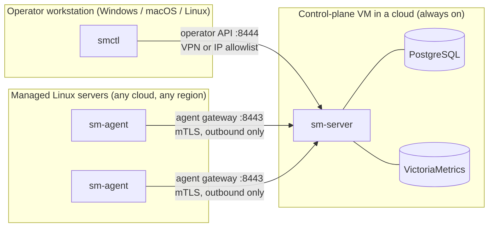

# Requirements

Status: **v1.0** · Last updated: 2026-11-20 · Companion to [ARCHITECTURE.md](ARCHITECTURE.md) and
[DEVELOPMENT_PLAN.md](DEVELOPMENT_PLAN.md)

## 1. Context

An operator manages a fleet of **Linux servers in one or more clouds** (Hetzner, DigitalOcean,
AWS, …) from a **personal workstation running Windows, macOS or Linux**. There is no
always-on office network; the workstation is a laptop that is often off, behind NAT, and
on changing networks.

This shapes the deployment model:

- The **control plane runs on a small, always-on cloud VM** (or on one of the managed servers),
  never on the workstation: agents must be able to reach it at any time, jobs queue there
  while the operator is offline, and metrics keep arriving.
- The **workstation only runs `smctl`** (later also the web UI in a browser). Nothing needs to be
  installed on it besides one binary.
- Managed servers expose **no management port**; agents dial out.

## 2. Functional requirements

Status: ✅ done · 🟡 partial · ⏳ planned (phase).

| ID | Requirement (from the original brief) | Status | Where |
|----|----------------------------------------|--------|-------|
| F-01 | Fleet dashboard: CPU, memory, disk, network, load, uptime, online state | ✅ | `smctl dashboard` (1.5) |
| F-02 | Manage databases (MySQL/MariaDB, PostgreSQL): users, DBs, backups | ⏳ P4 | 4.2–4.3 |
| F-03 | Docker and containers: list, logs, stats, start/stop, prune | ⏳ P2 | 2.1 |
| F-04 | Server audit logs: SSH logins, sudo, journald; operator actions | ✅ / 🟡 | `smctl logins`, `smctl logs`, hash-chained audit log; auditd later (P3) |
| F-05 | Server traffic: per-interface rates and totals | 🟡 | rates in metrics; top talkers, monthly totals P4 (4.6) |
| F-06 | Banned / failed IPs (fail2ban, CrowdSec), fleet-wide bans | ⏳ P3 | 3.4 |
| F-07 | Timezone and NTP | ⏳ P2 | 2.4 |
| F-08 | Disk cleanup (journal, package caches, old kernels, Docker) with dry run | ⏳ P2 | 2.2 |
| F-09 | Swap: create, resize, remove, swappiness | ⏳ P2 | 2.3 |
| F-10 | Firewall with automatic rollback | ⏳ P3 | 3.1–3.3 |
| F-11 | Services: list, start/stop/restart/reload, enable/disable | ✅ | `smctl services` (1.6) |
| F-12 | Processes: list, top, signal | ✅ | `smctl processes` (1.7) |
| F-13 | Security posture: SSH config, updates, open ports, score | ⏳ P3 | 3.5–3.6 |
| F-14 | Domains and TLS certificates, DNS records | ⏳ P4 | 4.4–4.5 |
| F-15 | Package updates (security only, reboot-required) | ⏳ P2 | 2.5 |
| F-16 | Bulk actions on groups of servers | ⏳ P2 | 2.6 |
| F-17 | Alerts (agent offline, disk, certificate expiry, login spikes) | ⏳ P3 | 3.8 |

## 3. Non-functional requirements

### Security

| ID | Requirement | Status |
|----|-------------|--------|
| S-01 | Managed servers listen on no management port | ✅ |
| S-02 | Mutual TLS for agents; per-server identity; immediate revocation | ✅ |
| S-03 | Operators need password + mandatory MFA; fresh MFA for high-risk actions | ✅ |
| S-04 | Role-based access per server group | ✅ |
| S-05 | Only typed actions; no remote shell outside break-glass | ✅ |
| S-06 | Privileged work in a separate root helper with no network | ✅ |
| S-07 | Tamper-evident audit log of every action and login | ✅ |
| S-08 | Signed releases; install script verifies checksums (and signatures with cosign) | ✅ |
| S-09 | Secrets encrypted at rest | 🟡 TOTP secrets; general secrets P4 |
| S-10 | Operator API not exposed to the internet (VPN or IP allowlist) | 🟡 documented; see N-02 |

### Network and deployment

| ID | Requirement | Status |
|----|-------------|--------|
| N-01 | Agents in different clouds and regions reach the control plane over the internet when there is no private network between them | 🟡 works (mTLS-only agent port); now documented, see ADR 0009 |
| N-02 | The operator API (:8444) can stay private while new servers can still enroll | ⏳ P2 2.10: enrollment is currently served on the API listener, so it must be reachable by new servers; a separate enrollment exposure is needed |
| N-03 | One-command control-plane deployment on a small VM (sm-server + PostgreSQL + VictoriaMetrics) | ⏳ P2 2.9: packages exist; a production compose bundle and quickstart are missing |
| N-04 | The workstation can be offline: jobs queue, metrics are buffered, nothing depends on it | ✅ |
| N-05 | Control-plane backups (database + PKI directory) | 🟡 documented; automated job P4 |

### Operator workstation (Windows, macOS, Linux)

| ID | Requirement | Status |
|----|-------------|--------|
| W-01 | `smctl` runs natively on Windows, macOS and Linux (amd64, arm64) | ✅ release binaries; cross-compile checked in CI |
| W-02 | First login without copying files from the server: trust the control plane by its public-key pin (like `sm-agent enroll`) | ⏳ P2 2.11 (`smctl login --pin`; today `--ca-file root.crt` is required) |
| W-03 | Several control planes (e.g. staging, production) with named contexts | ⏳ P2 2.11 |
| W-04 | Password prompt never echoes; works in Windows Terminal, PowerShell, cmd and Git Bash (mintty) | 🟡 works in native consoles; mintty (Git Bash) has no console handle, so the password is read as a plain line and echoes; P2 2.12 |
| W-05 | `--watch` and the TUI render correctly in Windows consoles | 🟡 Windows Terminal yes; legacy conhost needs virtual-terminal mode enabled; P2 2.12 (Bubble Tea handles this for the TUI) |
| W-06 | Session token stored with user-only access; OS keychain later | 🟡 0600 file in the user config directory (`%AppData%\smctl` on Windows); keychain P5 |
| W-07 | Easy install: Homebrew, Scoop/winget, .deb/.rpm | 🟡 .deb/.rpm and raw binaries; package managers P5 |

### Development environment

| ID | Requirement | Status |
|----|-------------|--------|
| D-01 | Developers on Windows, macOS and Linux can build and test the control plane and smctl | ✅ |
| D-02 | The agent is developed and tested on Linux (WSL2 on Windows, a Linux VM or Docker on macOS) | ✅ documented |
| D-03 | Shell scripts keep LF line endings on Windows checkouts | ✅ `.gitattributes` |
| D-04 | Claude Code project configuration (instructions, permissions, formatting hook) | ✅ `CLAUDE.md`, `.claude/` |

## 4. Findings from the 2026-11-20 review

The architecture fits the "laptop operator, cloud servers" model: agents dial out, the
control plane holds the queue and state, and `smctl` is a single cross-platform binary. The
review found these gaps, now tracked in the plan:

1. **Where the control plane runs** was implicit. It must be an always-on cloud VM; section 1
   and [INSTALL.md](INSTALL.md) now say so.
2. **Network exposure** assumed one private network for everything. With servers across
   clouds, the agent port is commonly internet-facing; that is acceptable because it
   accepts only recorded mTLS client certificates (ADR 0009). The operator API should stay on
   a VPN or IP allowlist.
3. **Enrollment** is on the operator API listener, which conflicts with keeping that listener
   private (N-02 → task 2.10).
4. **Control-plane deployment** needs a ready compose bundle for a small VM (N-03 → 2.9).
5. **Laptop onboarding** requires copying `root.crt`; a pin-based `smctl login` and named
   contexts make multi-environment use practical (W-02, W-03 → 2.11).
6. **Windows console details**: password echo under Git Bash/mintty and escape sequences
   in legacy consoles (W-04, W-05 → 2.12).
7. **Line endings**: Windows checkouts converted shell scripts to CRLF, which breaks them in
   Git Bash, WSL and on servers (D-03, fixed with `.gitattributes`).
